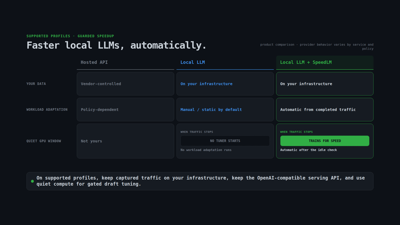
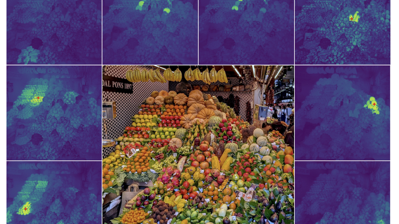
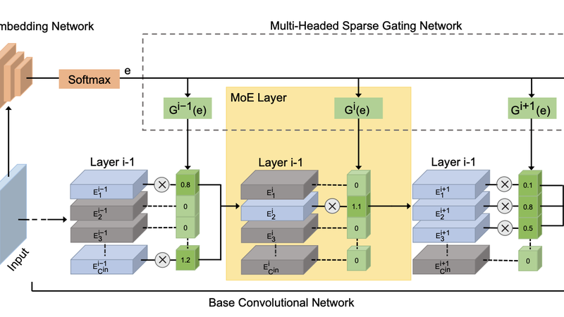

  <a href="https://github.com/RyanKim17920" target="_blank" rel="noopener" class="contact-btn">
    <i class="fa-brands fa-github"></i>GitHub
  </a>
  <a href="https://www.linkedin.com/in/ryankim17920/" target="_blank" rel="noopener" class="contact-btn">
    <i class="fa-brands fa-linkedin"></i>LinkedIn
  </a>
  <a href="mailto:ryankim17920@gmail.com" class="contact-btn">
    <i class="fa-solid fa-envelope"></i>Email
  </a>
  <a href="/assets/pdf/cv.pdf" target="_blank" rel="noopener" class="contact-btn">
    <i class="fa-solid fa-file-pdf"></i>CV
  </a>

I’m Ryan Kim — a Computer Science student at UIUC (Class of 2029). First-author paper at a NeurIPS 2026 workshop · Sole-author paper under review · Founding team, a16z AI startup.

<h2 class="section-heading">
  Experience
  click any row to expand
</h2>

  

    

      &#9656;
      D
      

        

          
<strong>RL Intern (Founding Team)</strong> · <a href="https://delightfullabs.ai" target="_blank" rel="noopener">Delightful AI</a> (a16z speedrun-backed)

          
Aug 2026 — Present

        

        

          RL EnvironmentsLLM AgentsDockerHarbor
        

      

    

    

      <ul>
        <li>Built bioinformatics agent RL environments (Chimera) end to end that hold GPT-6 Astra, Claude Opus 5.5, and Fable 5.1 to &lt;0.5/1.0 reward: a synthetic generator of verified-solvable tasks, Docker/Harbor execution, and reward grading.</li>
        <li>Sped up task generation 6&times; by adding caching and parallelism to the generator pipeline.</li>
        <li>Analyzed agent trajectories with an LLM-as-a-judge that checks each run against expected milestones.</li>
      </ul>
    

  

  

    

      &#9656;
      
      

        

          
<strong>Undergraduate Researcher</strong> · BLENDER Lab, UIUC (with Alexi Gladstone)

          
Aug 2026 — Present

        

        

          Energy-Based TransformersExplorative Modeling (XM)LLM ArchitectureScaling Laws
        

      

    

    

      <ul>
        <li>Led research extending Energy-Based Transformers to multi-token prediction through Explorative Modeling (XM).</li>
        <li>Implemented the full training stack and compared candidate energy formulations against block-diffusion LLMs; running scaling-law studies for Energy-Based Transformers.</li>
      </ul>
    

  

  

    

      &#9656;
      
      

        

          
<strong>Research Intern (prev. ML Research Contributor, MedARC)</strong> · <a href="https://sophont.med" target="_blank" rel="noopener">Sophont</a>

          
Apr 2026 — Present

        

        

          HistopathologyNanoPathModel RobustnessLLM Agents
        

      

    

    

      <ul>
        <li>Drove 37% of the gain over baseline on <a href="https://labless.dev/nano-projects/nanopath" target="_blank" rel="noopener">NanoPath v1</a> (3rd-author paper, accepted at a NeurIPS 2026 workshop) and over 50% on <a href="https://labless.dev/nano-projects/nanobrain-smri" target="_blank" rel="noopener">NanoBrain</a> by building an LLM autoresearch agent with dual-branch search and anti-overfitting cycles.</li>
        <li>Cut config errors 80% and token use 15&times; by designing agent infrastructure (knowledge graphs, SLURM, worktree isolation).</li>
        <li>Raised mean PathoROB robustness 0.726&rarr;0.891 and improved downstream AUC across 7 pathology foundation models by introducing <a href="https://openreview.net/forum?id=Gs7BZ9XI3r" target="_blank" rel="noopener">SPECTRA</a>, label-free contrastive LoRA fine-tuning (first-author paper, accepted at a NeurIPS 2026 workshop).</li>
      </ul>
    

  

  

    

      &#9656;
      
      

        

          
<strong>Pathology AI Research Intern</strong> · <a href="https://ihlab.med.cornell.edu/" target="_blank" rel="noopener">AI in Medicine &amp; Computational Biology Lab, Weill Cornell Medicine</a>

          
Oct 2024 — Jul 2026

        

        

          Computer VisionGeneralizationTCGATumor Purity
        

      

    

    

      <ul>
        <li>Found that error doubles out of distribution (MAE ~0.10&rarr;~0.20) by benchmarking 12 vision foundation models for tumor-purity regression on TCGA and internal cohorts in PyTorch.</li>
      </ul>
    

  

  

    

      &#9656;
      
      

        

          
<strong>Computational Oncology Research Intern</strong> · <a href="https://www.mskcc.org/research-areas/research-teams/advanced-computing-and-oncology-lab" target="_blank" rel="noopener">Advanced Computing &amp; Oncology Lab, Memorial Sloan Kettering</a>

          
Dec 2024 — Jan 2026

        

        

          LLMsDSPyClinical NLPOncology
        

      

    

    

      <ul>
        <li>Engineered a CPU-only LLM pipeline that classified 370 clinically annotated lung-cancer CT reports, optimizing prompts for Llama 3.1-8B and Qwen3-4B with DSPy MIPROv2 (3rd-author abstract, accepted at ACRO 2026).</li>
      </ul>
    

  

  

    

      &#9656;
      
      

        

          
<strong><a href="https://www.stonybrook.edu/simons/" target="_blank" rel="noopener">Simons Summer Research Fellow (Computational Genomics)</a></strong> · <a href="https://ayurovsky.github.io/" target="_blank" rel="noopener">Yurovsky Lab</a>, Stony Brook University (<a href="https://www.simonsfoundation.org/" target="_blank" rel="noopener">Simons Foundation</a>)

          
Jun 2025 — Aug 2026

        

        

          GenomicsDNABERTCox RegressionGlioblastoma
        

      

    

    

      <ul>
        <li>Predicted survival of 185 glioblastoma patients with a DNABERT-based Cox model on non-coding DNA mutations.</li>
      </ul>
    

  

  <a href="/assets/pdf/cv.pdf" target="_blank" rel="noopener">Full CV (PDF) →</a>

<h2 class="section-heading">
  Research
  <a class="section-more-inline" href="/publications/">All publications →</a>
</h2>



<h2 class="section-heading">
  Selected Projects
  <a class="section-more-inline" href="/projects/">All projects →</a>
</h2>

  <a class="project-card" href="/projects/qwen-expthink/">
    

      <h3>Qwen3.6-27B ExpThink</h3>
      2026
    

    
Cut thinking tokens 52% in-domain / 34% OOD and truncation 6.0%&rarr;2.6% while mean OOD accuracy rose 84%&rarr;86% by post-training Qwen3.6-27B with a length-adjusted GRPO reward.

    
GRPO Post-Training · LLM · RL

    huggingface.co/ryankim17920/qwen3p6-27b-expthink-step60
  </a>

  <a class="project-card" href="/projects/speedlm/">
    
    

      <h3>speedLM</h3>
      2026
    

    
Built a custom vLLM server that fine-tunes EAGLE-3 draft models on captured local traffic during idle GPU time. Raised tokens accepted per verification step 13.4% over the stock draft on held-out Qwen3-8B data.

    
LLM · vLLM · Speculative Decoding

    github.com/RyanKim17920/speedlm
  </a>

  <a class="project-card" href="/projects/microdinov3/">
    
    

      <h3>microDINOv3</h3>
      2026
    

    
DINOv3 in dependency-free pure Python — hand-written reverse-mode autograd and ViT, EMA teacher-student distillation, DINO + iBOT objectives, KoLeo regularization, axial RoPE with register tokens, and Gram anchoring.

    
Pure Python · CV · Self-Supervised

    github.com/RyanKim17920/microDINOv3
  </a>

  <a class="project-card" href="/projects/deepmoe/">
    
    

      <h3>DeepMoE Reproduction</h3>
      2024
    

    
PyTorch reproduction of "Deep Mixture of Experts via Shallow Embedding," recovering the paper's accuracy-vs-compute tradeoff on CIFAR-10.

    
PyTorch · CV · Paper Reproduction

    github.com/RyanKim17920/Deep-Mixture-of-Experts-via-Shallow-Embedding
  </a>

<h2 class="section-heading">Skills</h2>

  

    
Languages

    

      
Python

      
C/C++

      
Java

      
SQL

      
JavaScript

    

  

  

    
ML / LLM

    

      
PyTorch

      
Hugging Face

      
vLLM

      
Scikit-learn

      
Polars

      
Pandas

      
NumPy

    

  

  

    
Web / Backend

    

      
React

      
Node.js

      
FastAPI

    

  

  

    
Tools

    

      
Slurm

      
Docker

      
Linux

      
Git

    

  

