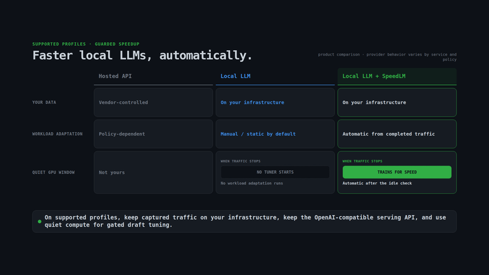
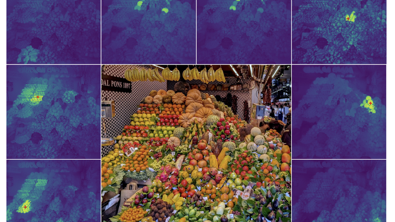
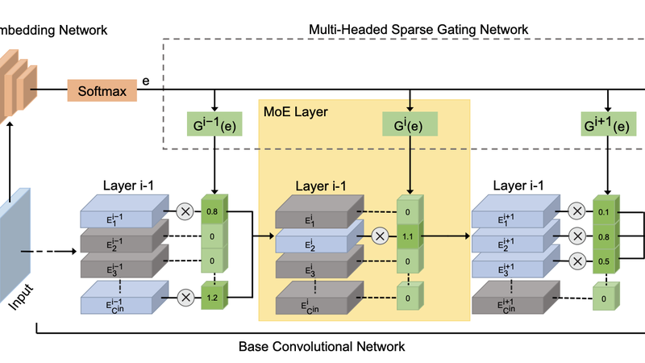

  <a class="project-card" href="/projects/mechanistic-sps/">
    

      <h3>Which State Should Prediction Read?</h3>
      2026
    

    
Sole-author paper, under review. Reached a FLOP-matched Transformer&rsquo;s loss on 2.1&times; fewer tokens and ended 0.064 nats/token lower after 20B tokens by designing Sequential, a final-state-read architecture, from these ablations (92M non-embedding params).

    
LLM Architecture &amp; Interpretability

    github.com/RyanKim17920/mechanistic-sps
  </a>

  <a class="project-card" href="/projects/qwen-expthink/">
    

      <h3>Qwen3.6-27B ExpThink</h3>
      2026
    

    
Cut thinking tokens 52% in-domain / 34% OOD and truncation 6.0%&rarr;2.6% while mean OOD accuracy rose 84%&rarr;86% by post-training Qwen3.6-27B with a length-adjusted GRPO reward.

    
GRPO Post-Training · LLM · RL

    huggingface.co/ryankim17920/qwen3p6-27b-expthink-step60
  </a>

  <a class="project-card" href="/projects/speedlm/">
    
    

      <h3>speedLM</h3>
      2026
    

    
Built a custom vLLM server that fine-tunes EAGLE-3 draft models on captured local traffic during idle GPU time. Raised tokens accepted per verification step 13.4% over the stock draft on held-out Qwen3-8B data.

    
LLM · vLLM · Speculative Decoding

    github.com/RyanKim17920/speedlm
  </a>

  <a class="project-card" href="/projects/microdinov3/">
    
    

      <h3>microDINOv3</h3>
      2026
    

    
DINOv3 in dependency-free pure Python — hand-written reverse-mode autograd and ViT, EMA teacher-student distillation, DINO + iBOT objectives, KoLeo regularization, axial RoPE with register tokens, and Gram anchoring.

    
Pure Python · CV · Self-Supervised

    github.com/RyanKim17920/microDINOv3
  </a>

  <a class="project-card" href="/projects/deepmoe/">
    
    

      <h3>DeepMoE Reproduction</h3>
      2024
    

    
PyTorch reproduction of "Deep Mixture of Experts via Shallow Embedding," recovering the paper's accuracy-vs-compute tradeoff on CIFAR-10.

    
PyTorch · CV · Paper Reproduction

    github.com/RyanKim17920/Deep-Mixture-of-Experts-via-Shallow-Embedding
  </a>

  <a class="project-card" href="/projects/spectra/">
    

      <h3>SPECTRA</h3>
      2026
    

    
Raised mean PathoROB robustness 0.726&rarr;0.891 and improved downstream AUC across 7 pathology foundation models (first-author paper, accepted at a NeurIPS 2026 workshop).

    
Label-free contrastive LoRA fine-tuning

    openreview.net/forum?id=Gs7BZ9XI3r
  </a>

  <a class="project-card" href="/projects/nanopath-autoresearch/">
    

      <h3>LLM Autoresearch Agent (NanoPath)</h3>
      2026
    

    
Drove 37% of the gain over baseline on NanoPath v1 and over 50% on NanoBrain by building an LLM autoresearch agent with dual-branch search and anti-overfitting cycles.

    
LLM Agents

    labless.dev
  </a>

